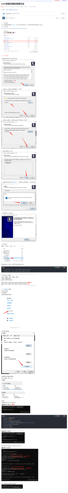

记录vue2或者vue3项目的配置和启动

<!-- more -->


### vue2

#### wx-xiaotao-main项目

1、该项目用到的是vue2


#### vue-admin-system项目

1、该项目用到的是vue3，需要更高的node版本，所以安装了nvm管理node版本。旧版本的node也会包含到nvm中，npm配置需要改到nvm相关目录下，可以多版本npm共享一个配置。
.npmrc配置

```
prefix=C:\NVM\node_global
cache=C:\NVM\node_cache
registry=https://registry.npm.taobao.org/
strict-ssl=false
```



> 原文： https://blog.csdn.net/maoge_666/article/details/127886789


2、该项目还用到了yarn，使用npm全局安装Yarn：

```
npm install -g yarn
```